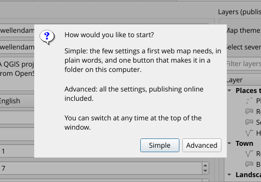
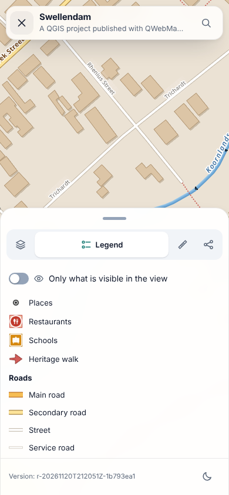

<br>

<div align="center">


# QWebMap

[](https://github.com/danzig666/QWebMap/issues)
[](https://github.com/danzig666/QWebMap/releases)
[](https://github.com/GallPeters/QGIS2VectorTiles)
[](https://www.gnu.org/licenses/old-licenses/gpl-2.0-standalone.html)

**Publish your QGIS project to the web in one click — and it keeps its QGIS look.**

**Your QGIS symbology, converted accurately to vector tiles** · one-click publishing ·
a full web viewer · no map server, database or Docker

> **QWebMap** by Ábel Kőszeghy started as a fork of
> [GallPeters/QGIS2VectorTiles](https://github.com/GallPeters/QGIS2VectorTiles) by Jossef Kanter
> and grew into a complete web map publisher. Download the
> [latest release](https://github.com/danzig666/QWebMap/releases/latest) and report issues
> [here](https://github.com/danzig666/QWebMap/issues). It installs as **QWebMap**
> next to the official QGIS2VectorTiles plugin.

<a href="https://danzig666.github.io/QWebMap/">
<kbd>

</kbd>
</a>

<a href="https://danzig666.github.io/QWebMap/"><b>🗺️ Try the live demo map</b></a> &nbsp;·&nbsp; <a href="https://danzig666.github.io/QWebMap/usage/"><b>📖 User guide</b></a> &nbsp;·&nbsp; <a href="https://danzig666.github.io/QWebMap/#video"><b>▶ Watch the full video (1080p)</b></a>

<sub>Demo data: Swellendam from the <a href="https://github.com/qgis/QGIS-Training-Data">QGIS training data</a> (GPL-2.0, from OpenStreetMap).</sub>

</div>

<br>

## Install

QWebMap needs QGIS 3.44 or newer, and runs on **QGIS 4 (Qt6)** too: the whole test suite runs
nightly on both QGIS 3 (Qt5) and QGIS 4 (Qt6). Download `QWebMap-<version>.zip` from the
[latest release](https://github.com/danzig666/QWebMap/releases/latest) (not the `-hu` file: that is a
special Hungarian zoning-plan edition, not for general use), then *Plugins → Manage and Install
Plugins → Install from ZIP*. Install a newer ZIP the same way to upgrade.

## ⭐ Your QGIS symbology, accurately on the web

Most web map exporters keep your data and lose your styling. QWebMap converts the **QGIS
symbology itself** into vector tiles and a MapLibre style, so the web map looks like your QGIS
map: same colours, widths, patterns, icons, dashes and labels, at every zoom level. The tiles
stay vector (sharp, small and fast). Most of what cannot be drawn natively in the browser is
rendered by QGIS into sprites or pre-computed geometry; the rest is approximated or left out (see
[Fidelity report](#fidelity-report)).

<p align="center">

<br><sub>Left: QGIS. Right: the published web map (vector tiles drawn by the browser). Same project, same view; the browser places labels itself, so a few differ.</sub>
</p>

What carries over:

- **Renderers:** single symbol, categorized, graduated and rule-based (nested rules, scale ranges,
  ELSE rules), merged features, inverted polygons, heatmap (drawn by the browser with QGIS's
  radius and colours), point cluster and point displacement (grouped with QGIS's method per
  eighth of a zoom; QGIS groups only the points in view, so some groups differ, reported); symbol
  levels and QGIS's feature order (*Control feature rendering order*).
  **Diagrams** (pie, histogram, stacked bar and text) are drawn by the browser from each
  feature's values, with QGIS's sizes (fixed or interpolated, scaled by area), colours, start
  angle and direction, bar orientation and scale range, over the feature like QGIS places them
  (data-defined diagram settings other than *Show*, the histogram axis and an *around*
  placement's distance are not reproduced; reported).
  Overlapping lines and polygons of different categories or rules also keep QGIS's order, up to
  5,000 re-ordered features and 8 levels of overlap per layer, in layers of up to 100,000 features
  (beyond that, rule order, reported; layers with inner shadow or inner glow lines keep rule
  order). The layer's opacity (*Layer Rendering*) fades its symbols, not its labels, as in QGIS;
  QGIS blends the layer as one image, the browser each style layer, so overlaps come out a little
  darker. Point layers are drawn
  rule by rule, and a symbol with several layers (a road casing and its fill) is drawn one layer
  at a time for all features, as with symbol levels.
- **Fills:** solid fills and outlines (with their offsets), line-pattern hatches, point-pattern,
  SVG and raster pattern fills at their exact QGIS size, starting where QGIS starts them (*Align
  pattern to*); point patterns as whole markers or clipped to the shape, as set in QGIS; SVG fills
  without seams at tile edges and rotated as one texture; gradient fills (linear, radial and
  conical, two colours or a colour ramp, pad, reflect or repeat) and shapeburst fills as fine
  colour bands; centroid (point-on-surface) markers; random marker fills (approximated).
  Clipping to the shape is exact for screen-unit patterns and for simple line, cross and closed
  markers; other map-unit markers on the edge are drawn whole and rotated map-unit point patterns
  unrotated (both reported); in a rotated map-unit SVG fill each tile is turned but the grid is
  not (reported).
- **Lines:** widths, offsets (QGIS's offset line where sharp corners need it), caps, joins and
  dash patterns (including map-unit custom dashes); marker lines with markers at the QGIS
  positions (interval, vertices, centre point; data-defined intervals, and screen-unit intervals
  with *Fast marker lines* on, are placed by the browser instead); hash lines, arrows (the polygons QGIS builds), filled lines,
  lineburst, raster-image and interpolated lines, and geometry generators; outer glow and drop
  shadow on simple lines, and inner shadow and inner glow on solid simple lines with a width in
  screen units (no dashes, offset or data-defined properties). Marker and hash lines keep QGIS's
  *trim distance* at the start and end, *blank segments* and *extra items* (QGIS 4), also
  data-defined; line trims, fill offsets and arrow widths, head sizes and types can be
  data-defined.
- **Markers:** simple markers (native circles when possible), SVG markers (also data-defined
  variants), ellipse, filled and raster markers rendered by QGIS into sprites (pixel sizes kept
  on high-resolution screens); font markers as browser text in your font (static map-unit
  characters as their exact glyph outlines); vector field markers as lines.
- **Labels:** your installed fonts (glyphs are generated from them, bold, italic and weights such
  as DemiBold, Medium and Light included), buffers, background shapes, letter and word spacing, curved,
  parallel, Free (angled) and around-point placement, scale-based visibility, data-defined
  positions (their callouts as straight leaders to the label's anchor, reported), callouts of
  point labels (simple, Manhattan, curved and balloon, as QGIS draws them), and an option to
  label every feature. HTML-formatted labels (each part keeps its colour, bold, italic, font
  family and size, up to 16 parts); QGIS type case (also data-defined); *Force point inside
  polygon*; point symbols with *Features act as obstacles* keep other labels off them; QGIS 4's
  *split label text lines over parts*, curved labels with *characters at vertices* (drawn even where
  they collide, where QGIS drops the label) and stretched character and word spacing (in the QWebMap
  viewer).
- **Data-defined properties:** evaluated by QGIS for each feature (`@symbol_color` included, and
  `rand()` gives every marker of a pattern fill its own value, as in QGIS); a property with no
  browser equivalent keeps its static value and is reported.
- **Units:** millimetres, points, pixels, inches, map units and metres at scale, with sizes
  computed per zoom level.

Every built-in QGIS symbol layer type is converted except the linear referencing line, which is
reported as unsupported and left out. Animated markers (GIF, WebP, animated PNG) play in the
browser at their QGIS frame rate (still when printing or when the visitor's system asks for
reduced motion). Selective masks are approximated: a label's mask becomes its halo and a mask
marker its shape, both in the map's background colour, so they cover everything under them, not
only the masked symbol layers (exact over a plain background; reported).

<p align="center">

<br><sub>Close-ups from the same project, each pair QGIS | QWebMap.</sub>
</p>

### What doesn't work (yet)

Most QGIS styling carries over (see above), but not all of it. **Every export writes a fidelity
report** that lists what was approximated or left out in *your* project, with the layer (and the
rule or symbol layer when known) and usually a suggested fix. A *Strict* mode refuses to publish
when the report has an error, or a warning about an unsupported or approximated component. The
generated table of every symbol layer type's strategy and limits is in
[`docs/fidelity/CAPABILITIES.md`](docs/fidelity/CAPABILITIES.md).

**Not drawn on the web map**

- **2.5D renderer and embedded-symbol renderer** (styles stored inside KML, DWG and similar files):
  the layer is not drawn (reported). For buildings, the viewer has its own optional 3D buildings.
- **Label shadows of background shapes:** not drawn (reported).
- **Paint effects on fills and other lines:** blur, colorise, transform, glows and shadows are
  ignored (reported). Exceptions: outer glow and drop shadow on simple lines; inner shadow and
  inner glow on solid simple lines with a screen-unit width; markers, which QGIS renders into images
  with their effects included.
- **Blend modes on vector layers and features** (multiply, overlay, darken and so on): drawn as
  normal, with a warning in the Publish window. Raster layers in *Multiply* or *Screen* mode are
  converted to an equivalent image; other raster blend modes are drawn as normal (warning).
- **Linear referencing line** (QGIS 3.40+) and **symbol layers from plugins:** left out (reported).
- **Data-defined properties with no browser equivalent:** the static value is used (reported).
- **Diagram details:** data-defined diagram settings other than *Show*, the histogram axis, the
  distance of an *Around* placement, and text-diagram shapes other than the ellipse.
- **Map content that isn't a vector or raster layer:** mesh, point cloud, vector tile and
  annotation layers, and map decorations such as the grid, title and copyright, are not published.
  Time-based layers are published as one snapshot, with no time slider.

**Drawn, but only approximately**

- **Selective masks:** a label's mask becomes its halo, and a mask marker its shape, both in the
  map's background colour. They cover everything beneath them, not only the masked symbol layers,
  so the result is exact only over a plain background (reported).
- **Random marker fills:** the same number and density of markers, but at different random
  positions.
- **Map-unit pattern fills:** markers on the polygon edge are drawn whole instead of clipped,
  rotated map-unit point patterns are not rotated, and in a rotated map-unit SVG fill each tile is
  turned but the grid is not (reported).
- **Label callouts:** callouts of point labels are drawn as QGIS draws them; a label placed
  around its point keeps its first position (QGIS may move it), reported. Callouts of labels
  with data-defined positions are straight leaders to the label's anchor (reported). Callouts of
  line and polygon labels, which the browser places itself, are left out without a report entry.
- **Label placement:** close to QGIS's, but the browser places labels itself, so in crowded areas
  other labels can win.
- **Feature order across rules:** overlapping features of different rules keep QGIS's order up to
  5,000 re-ordered features and 8 levels of overlap per layer, in layers of up to 100,000 features;
  beyond that, rule by rule (reported).
- **ELSE rules** whose sibling rules have children of their own: the ELSE condition looks only at
  its direct siblings (reported).
- **Layer opacity:** QGIS fades the layer as one image, the browser each style layer, so overlaps
  come out a little darker.
- **Inner shadow and inner glow on lines:** computed for straight lines, so they can differ where
  lines overlap or nearly touch.
- **Label shadows:** a soft copy of the label (or its buffer) in the shadow colour at the
  shadow's offset (a point label's shadow appears with its label, a moment after it is placed). The blur is capped at about a pixel, and a shadow's scale
  and an offset turned with the label are not reproduced (reported). Not drawn at all (reported):
  the shadows of point labels placed *around point* or *cartographic* (several candidate
  positions), the shadow of a label's background shape, and shadows sized in map units.
- **HTML labels:** background colours of text parts are not drawn, and a label with more than 16
  differently formatted parts draws the rest of its text in the 16th part's format (reported).
- **Heatmaps:** the colours can scale differently from QGIS unless the renderer has a fixed
  maximum value (reported).
- **Point clusters and point displacement:** grouped with QGIS's method, but QGIS groups only the
  points in view, so some groups differ (reported).

## Fidelity report

Every export writes `fidelity_report.json` and `fidelity_report.html`: next to the tiles for the
Processing tool, and for *Publish Web Map* in the work folder
`<Local output folder>/.q2vt-work/<slug>/<export>/` (never uploaded). Each entry names a stable
code (`Q2VT_*`), where it happened (the layer, plus the rule or symbol layer when known), the
export strategy when one applies, and usually a suggested fix, so missing hatches or unsupported
symbols are visible without reading the log. A few differences are not in the report: the
callouts of line and polygon labels are left out without an
entry, and blend modes on vector layers only get a warning in the Publish window.

Both the Processing tool (*Fidelity Mode*, *Beyond Maximum Zoom*) and the Publish Web Map window
(*Output* tab: *Fidelity*, *Beyond the maximum zoom*) have these settings:

- **Fidelity Mode**: *Vector-first* (default) exports what it can and reports
  approximations; *Strict* fails before anything is published if the report has an error or a
  warning about an unsupported or approximated component (information notes do not count).
- **Beyond Maximum Zoom**: keep showing the last generated tiles (overzoom) or hide all
  layers above the export's maximum zoom.

Developer documentation: [`docs/fidelity/`](docs/fidelity/) — baseline and confirmed
defects, how to run the three test levels, the generated symbol compatibility table, and
the status of each item of the fidelity plan.

## Publish Web Map

*Web → QWebMap: Publish Web Map…* (also on the Web toolbar) opens a window that turns the project
into a public, self-contained web map. The window title shows the plugin version.

**Simple** / **Advanced** at the top of the window switch between two views of the same settings:
the simple view only shows fewer of them, so switching never changes or loses anything. The
first time the window is opened it asks *How would you like to start?* (Simple or Advanced);
users of earlier versions keep the advanced view. The view you choose is remembered.

### Simple view

<p align="center">

<br><sub>The simple view.</sub>
</p>

For a first web map, or for occasional use: only the essential settings, in plain words. Its
**Make web map** button makes the map in a folder on this computer, whatever the advanced view's
*Destination* says.

1. **Title**: the address name is made from it.
2. **Layers**: *On the map* publishes the layer. *Show its information when clicked* makes a click
   show the feature's attributes (without ids); anyone who opens the map can see them. *Use the
   layers visible in QGIS* ticks exactly the layers visible in QGIS.
3. **Area**: *What the QGIS map shows now* or *The extent of a layer*, with its size and tile count.
4. **How close visitors can zoom**: a QGIS map scale from 1:100 000 to 1:500, in your project's
   CRS. *Choose automatically from the project* (on for new settings) picks the scale at which the
   smallest typical features of the published layers are clearly visible, and says why. A preview
   beside it draws your layers as QGIS does at that scale, where the area has most detail.
5. **Background map**: none, or OpenStreetMap (downloaded for the area while the map is made).
6. **Save in folder**.

After **Make web map**: **Open in browser** (served from this computer), **Open folder**, or **Make
a ZIP to send**. Settings that only the advanced view shows (a drawn area, the parcel report, web
basemaps, documents, a description) are kept, used and listed (*Also uses advanced
settings*); an online destination is kept for **Publish** but not used here. To put the map online, copy its folder to any web server, or use **Publish** in the
advanced view. See the [user guide](https://danzig666.github.io/QWebMap/usage/#simple-view).

<p align="center">

<br><sub>Asked once, the first time the window is opened.</sub>
</p>

### Advanced view

<p align="center">

<br><sub>The Publish Web Map window, advanced view, <i>Map</i> tab.</sub>
</p>

Every setting, publishing online included.

**Quick start**

1. *Map* tab: choose the extent and the layers (*Publish*, *At start*, *Switchable*).
2. *Interaction* tab: tick the fields that may appear in popups, search and filters.
3. *Export locally*, then *Preview* to see the web map in your browser.
4. *Destination* tab: set up Cloudflare R2, other S3-compatible storage or an SSH / SFTP server,
   or keep *Local only (no upload)* and copy the folder to a web server that supports Range
   requests.
5. *Review* tab: check what becomes public and tick the approval, then *Publish*.

### Choosing what to publish

- **Title and look** (*Map* tab): title, address name (slug), description (its first line is the
  subtitle), viewer language (English or Hungarian), attribution, logo and accent colour.
- **Zoom range** (*Map* tab): minimum and maximum tile zoom, and how far visitors can zoom in
  beyond the last tiles. *Use web zoom scales in QGIS…* sets the project's scale list to the
  scales of the web map's zooms, so the scale ranges you set in QGIS start and end exactly at a
  zoom.
- **Published area** (*Map* tab → *Extent*): *Current map view* (what the QGIS map shows at each
  export; the window asks before every such export, with the area's size and tile count, and can
  be told not to ask again for the project), *Extent of a layer* (follows the layer's data), or a
  *Fixed area*: drawn on the QGIS map (*Draw…*: click two opposite corners; right click or Esc
  cancels) or the view frozen (*Freeze view*). *Show on map* outlines the area on the QGIS map.
  *Keep the web map on the extent* (on by default) stops visitors from panning away.
- **Layers** (*Map* tab): per layer or group, *Publish*, *At start* (visible when the map opens)
  and *Switchable* (untick it to make a layer or group always shown); per layer, *Legend*.
  Publishing never changes the project's own layer visibility.
- **Finding layers** in projects with hundreds of them: the *Map* tab's filter box shows, as you
  type, the layers whose name contains the text (upper or lower case, accents not needed) with
  their groups, and *Only published layers* hides the rest. The *Interaction* tab lists the
  published layers by name, with a find box when there are more than 10. Every layer drop-down
  (extent, house numbers, parcel report, terrain, WMS) takes typing and lists the matching layers.
- **Zoomed-out load…** (*Map* tab): every layer's zooms, of its features and of its labels, and how
  it is drawn zoomed out, can be changed by hand, not only the suggested ones; the lowest zoom
  removes a limit (see [Tools for big maps](#tools-for-big-maps)).
- **Zoomed out** (*Map* tab → *Zoomed out* column, or *Selected layers → Zoomed out…*): below a
  zoom, a dense vector layer is drawn **merged** (the features of one style joined into one shape
  per tile: much lighter; the outlines between them and their popups are gone there) or as an
  **image** rendered by QGIS (exact, the lightest; no popups or highlighting there) instead of every
  feature. Its labels stay as text; from that zoom on every feature is drawn.
- **Many layers at once:** select rows (Ctrl/Shift + click), then *Selected layers* or right-click.
  *Publish the visible layers* publishes exactly what the QGIS Layers panel shows.
- **Map themes** (*Map* tab): *Publish its layers* adds a theme's layers (several themes add up),
  *Use as start view* sets what is visible at start, and the ticked themes become one-click views
  in the web map (*Start with* picks the view it opens with).
- **Web-only scales** (*Map* tab → *Scales* column, or *Selected layers → Visible scales…*): hide a
  layer, or only its labels, beyond a scale in the web map; there it is not tiled either. Without
  one, the column shows the layer's own QGIS range, for example "(QGIS 1:2 000 –)".
- **What QGIS shows is published:** temporary (memory) layers, joined and virtual fields, and
  unsaved edits.
- **Public fields** (*Interaction* tab, per layer): which fields appear in popups (with titles
  and types), are searchable, become filters or identify a feature for links. Only ticked fields
  become public.
- **Per-layer viewer settings** (*Interaction* tab): title in the viewer, feature title (an
  expression), initial opacity, feature links, *Label every feature* (a label that does not fit
  is drawn smaller instead of dropped), *Measurements snap to this layer*, and a *3D height field
  (m)* that raises polygons such as buildings in the 3D view (the heights become public).
- **Address search** (*Interaction* tab): *Search street names (OpenStreetMap)*, and a *House
  numbers* layer so visitors can search "Fő utca 12" (the street from a field, or the nearest
  OpenStreetMap street).
- **Raster layers** (orthophotos, scanned plans, rendered DEMs) are drawn by QGIS into their own
  image tiles; vector layers always stay vector tiles. Select one on the *Interaction* tab:
  *Image format* (WebP by default, falling back to PNG if QGIS cannot write WebP; PNG or JPEG),
  *Sharpest detail* (like the image, like the map, or a pixel size in metres, with an estimate),
  *Shown from zoom*, quality and opacity. *Like the image* publishes one zoom finer than the
  image, so rasters are as sharp as in QGIS. A web map can have only raster layers. A raster layer
  with very many tiles is not refused: before the export a warning names the layer, the setting
  that makes it large and what brings it down, and *Export anyway* goes on.
- **Live web tile and WMS layers**: an XYZ tile layer or a WMS layer of the project is loaded by
  the visitor's browser from its own server instead (*Load live from its server*, on by default
  for such layers): nothing is rendered into the release, and the map follows the service. It
  needs an `https` address without a QGIS login, and a server that allows other sites' pages to
  use its images (CORS; checked while exporting, otherwise the layer is rendered). Opacity,
  saturation, contrast and brightness come from QGIS. A click on a live WMS layer shows what the
  server knows there (GetFeatureInfo), and its legend comes from the server. WMTS layers are
  rendered.
- **Zoom to layer** (*Interaction* tab, off by default): a button in the web map's layer list
  zooms to the layer's features within the map's extent.
- **OpenStreetMap vector basemap** (*Basemap* tab, Protomaps): copied into the release in the
  styles you tick (light, dark, white, grayscale, black), from the latest Protomaps daily build
  (internet needed while exporting) or a PMTiles file, with its most detailed zoom, the area
  around the extent and overview zooms; you choose the basemap shown at start, and visitors switch
  it or turn it off.
- **Web basemaps** (*Basemap* tab): your QGIS XYZ tile connections, new ones (*Add new…*) and WMS
  services (*Add WMS…*, for example official orthophotos) with https:// addresses (web pages
  cannot load http:// tiles) in the viewer's basemap menu. Visitors' browsers load them from their
  server; nothing is copied.
- **Terrain** (*Basemap* tab): an elevation layer (DEM) gives an optional hillshade, elevation
  profiles of measured lines (with *Measurement* on) and the relief of the 3D view (with *3D view*
  on; both are off by default on *Interaction → Viewer*), with a height exaggeration for 3D.
- **About the map** (*Info* tab): *Issued by*, *Decree / plan number*, *In force from* and *Data
  as of*. The dates show under the map title; everything shows in the viewer's *About this map
  and documents* block and on prints.
- **Documents** (*Info* tab → *Add document…*): PDF, Word/ODT, RTF, text and image files are
  copied into the web map and listed in its panel; a popup value naming a document links to it.
- **Parcel report** (*Parcel report* tab; optional, made for zoning plans): clicking a parcel
  shows its area, its parts cut by the zoning and the regulation lines, its zones and every
  restriction touching it, with legend graphics (computed in QGIS from the exact geometry when
  exporting). Optional zone regulation table and full regulation texts. It prints zoomed on the
  parcel.

### Publishing and hosting

- **Export locally** builds the web map on this computer, in `<output folder>/<name>/`: one site
  with its own `index.html`, ready to copy to any web server. Each export replaces the previous
  one there (only files an earlier export wrote are removed; your other files stay). Tick *Keep
  earlier versions in the local folder* (*Output* tab) to keep each export as a version in
  `releases/` instead, with rollback. **Preview** (after an export, or for a map
  exported earlier into the output folder) serves it on `127.0.0.1` with byte ranges and opens your browser. Neither needs an account or an upload.
  They work offline unless the export reads OpenStreetMap data from the Protomaps build (the
  basemap, or, without a basemap, street-name search and house-number search without a street
  field), a published raster layer is
  an online service, or the map uses web basemaps or Street View.
- **Output** tab: PMTiles, or PMTiles plus an MBTiles copy next to the publication folder (the web
  map itself always uses PMTiles; *MBTiles only* cannot be uploaded), the local output folder, an optional offline ZIP of the release and the legacy XYZ web package.
  *Polygon labels* places polygon labels on the whole polygon, on its part visible on screen, or
  as set in each layer.
- **Publish** uploads an immutable release to **Cloudflare R2** or other S3-compatible storage
  that supports conditional writes (*Destination* tab), checks it through your public address,
  and only then switches the stable link, so the previous map stays online if anything fails.
  Unchanged files are copied inside the bucket instead of uploaded again. *Publish* reuses the
  last local export only if the layers' data, style, source and CRS are unchanged; otherwise it
  exports again.
- **Stable address:** it always opens the current release; each release also has its own
  address, so old links keep working until you delete that release.
- **Destination tab:** *Step-by-step: set up Cloudflare R2…* shows where each value is in the
  Cloudflare dashboard; *Test connection* checks the storage; *Show CORS policy* gives a policy to
  paste when the viewer runs on another address.
- **Rollback** (*Destination → Releases and rollback…*): make an earlier release current again,
  delete old releases or abort interrupted uploads; *Releases to keep* sets how many releases
  *Delete old releases…* keeps (nothing is deleted automatically).
- **SSH / SFTP server** (*Destination* tab): the map goes straight into one folder on your web
  server that you choose, replacing the previous map there (not versioned: no releases, no
  rollback). Only new and changed files are uploaded, `index.html` last, and only files QWebMap
  uploaded there before are ever deleted, so your other files in the folder stay (files with the
  same name as the map's are replaced). Uses the computer's OpenSSH client (key, ssh-agent or a
  password); see
  [HOSTING.md](docs/publishing/HOSTING.md#ssh--sftp-server-one-folder-not-versioned).
- **Sharing:** *Open map*, *Copy link* and **Copy embed code**, a ready `<iframe>` for another web
  page. The embedded map is compact, has an *Open the full map* link, zooms with the scroll wheel
  only while Ctrl/⌘ is held, and on touch screens moves only with two fingers, so page scrolling
  is not captured.
- **Any static web server** works: choose *SSH / SFTP server* to upload the map into a folder of
  it, or *Local only (no upload)* and copy the publication folder yourself.
  The map data is one **PMTiles** archive (raster layers, terrain and the basemap in their own
  archives; the search index, feature records and parcel report records in one file each), read
  with HTTP byte ranges, so no tile server, database or Docker is needed. **The web server must
  support HTTP Range requests** (`206 Partial Content`): Cloudflare R2, S3, nginx and Apache do;
  `python -m http.server` does not (the map then shows `Q2VT_PUB_RANGE_UNSUPPORTED`). Opening
  `index.html` as a `file://` page does not work at all: browsers block the viewer's modules
  there, so the page stays on "Loading…"; use *Preview*. Do not gzip `.pmtiles` and `.pack`
  files, and serve `.mjs` as `text/javascript`. See [HOSTING.md](docs/publishing/HOSTING.md).
- **Only the fields you approve are published as fields**; what the map draws is public too
  (geometry, label texts and other values the style computes from fields, approved or not). Every
  tile is checked before upload. *Output →
  Publish ALL attribute fields in the tiles* is an opt-in (not recommended), and the *Review* tab
  warns about it.
- **Review tab:** lists the target address, each published layer and its public fields, the
  basemap, terrain, documents, parcel report data, the third parties visitors' browsers contact
  (web basemaps, Google Street View) and the viewer extras that are on. The first publication, and
  any change to what becomes public, needs your approval.
- **Problems are found early:** repeated or missing feature keys, missing parcel report layers or
  fields, missing document files and house-number fields are reported in the first seconds of an
  export, with where to fix them.
- **Settings** are saved in the project (*Save settings*, then save the project file). Object
  storage keys and SSH passwords are not: they stay encrypted in the QGIS authentication database
  (*Save keys in QGIS…*, *Save in QGIS…*) or are typed for this session only. *Settings file…*
  exports the settings to a file (with the storage keys, secret included, when the destination
  has them: keep it private; on Linux and macOS it is saved readable only by you; never an SSH password) and
  imports them into another project, matching layers by name. The window asks before closing
  with changes it cannot save, and fits a 1366 × 768 screen (the widest tabs scroll). The Google Street View key is a
  project setting and is visible in the published page, so restrict it in Google Cloud.
- When the project was saved as another file, all settings and the same web map are kept; the window
  asks only where to export (keep the folder, `web_maps` next to the new file, or a chosen folder).
  A separate web map: export the settings to a file and import them as a new web map. *Preset…* fills the settings from domain conventions (only in
  editions that ship presets).

### The web viewer

<p align="center">


<br><sub>The web viewer on a desktop and on a phone.</sub>
</p>

On by default (each can be switched off on *Interaction → Viewer*):

- **Layers** tab: QGIS groups, layers and their legend rules with QGIS swatches, a lock on layers
  that are always shown, opacity sliders, one switch for all labels (without it, labels are always
  on), and *Reset*. Without it, visitors get the legend, with an on/off switch for each layer.
- **Search** in the approved fields of all layers; the chosen feature is zoomed to and marked,
  and its popup opened when popups are on.
- **Filters** by value lists (with counts), number ranges or text.
- **Popups** with the approved fields; a value naming a published document links to it; *Link to
  this feature* copies a link that reopens the map on that feature.
- **Share** tab: *Link to the current map (follows updates)* or *Link to this exact version*.
  Links keep the view, layers, labels, opacity, filters, basemap, selected feature and drawing.
- **Coordinates** of the pointer in WGS 84 and in the project's coordinate system (*Tools* tab).
- **Print** (*Tools* tab): a map extract of the current view at a chosen scale on A4 or A3,
  landscape or portrait, with a north arrow, a scale bar, the legend, and a header with the
  issuer, decree, dates, scale and print date.

*Map only: nothing on screen but the map* (*Interaction* tab) publishes a page with only the map:
no title, panel, legend, buttons, scale bar, popups or search (the attribution stays when there is
one). Visitors can still pan and zoom; for an embedded map, a kiosk screen or a background image.

Always there:

- **Legend** with symbols rendered by QGIS (and your legend patch shapes); *Only what is visible
  in the view* lists only what is drawn (*Interaction → Viewer* sets whether it starts on).
- **Views** bar with the QGIS map themes you offered (hidden when there is only one).
- Zoom, full screen and a scale bar; a **Basemap** menu (with a
  preview of each OpenStreetMap style) when the map has a basemap or web basemaps.
- **About this map and documents** at the bottom of the panel (a folded block, shown when the
  *Info* tab has data): issuer, decree, dates and the documents.
- **Desktop and phone:** a floating panel with tabs on desktop, a bottom sheet on phones; light
  and dark appearance (follows the system until the visitor chooses); your accent colour and logo.
- The visitor's layer, label, opacity, filter and basemap choices are remembered in their
  browser. A shared link shows the published map with the sender's changes instead, also when it
  is pasted into a tab where the map is already open.
- When the map cannot be shown (no WebGL, no Range support, a missing or damaged map file …), the
  viewer says why in plain words, with the technical detail. A basemap, terrain or symbol that
  fails to load gives a warning while the map still works.
- The viewer language (English or Hungarian) is set per map on the *Map* tab.
- **Zoom readout for checking:** `?debug` added to the map's address (`…/index.html?debug`) shows
  the map's zoom and the zoom of the tiles drawn at it (`?debug=tiles` also outlines the tiles).
  Not shown to visitors who did not ask for it.

Off by default (turn them on on *Interaction → Viewer*):

- **Map panel closed at start**: the map opens with more of it on screen; the menu button opens
  the panel.
- **My location button** (on HTTPS pages only): shows the visitor's location; outside the map's
  area it only shows a message.
- **Zoom-to-layer buttons** in the layer list (in the legend when there is no Layers tab).
- **Measurement** (*Tools* tab): distances and areas, snapping to the corners or edges of the
  layers you chose (hold Alt for a free point); right-click, double-click or Enter finishes,
  Backspace removes the last point. With terrain, a measured line gives an
  **elevation profile** (lowest and highest point, climb and descent).
- **Search street names (OpenStreetMap)** inside the map's area.
- **Overview map (inset)**: a small map in the corner with the current view; it can be folded
  away.
- **3D view**: tilts the map, raises polygons with a *3D height field* and shows the terrain
  relief.
- **Drawing tools** (*Tools* tab): points, lines, areas and text in a few colours. The drawing
  travels in the shared link (nothing is stored on the site) and can be saved as GeoJSON or KML.
- **Street View (Google)** (needs your Google API key): a button under the zoom buttons shows blue
  lines where Street View exists; a tap opens the nearest panorama looking toward the tapped
  spot, with a draggable viewpoint on the map. Works on phones. If the key lacks the Map Tiles
  API, the viewer says why the blue lines are missing.

### Speed

- **Reuse unchanged layers** (*Output → Reuse unchanged layers from earlier exports*, on by
  default; *Clear cache…*): layers whose data, style and settings did not change, raster layers
  included, are not processed again; the export log says why each other layer was redone.
  Database, web and temporary (memory) layers are always exported. (4.5: a re-export of a 40-layer zoning plan went
  from about 170 s to 15 s.)
- **Parallel export:** big exports use helper QGIS processes, cut tiles in parallel and in the
  background, and draw raster tiles on several cores, up to *Output → CPU limit (%)*. (4.28: an
  88-layer zoning plan from scratch in 54 s on 4 cores.)
- **Fast marker lines** (*Output*, off by default): the browser places marker lines spaced in
  screen units instead of the export computing them for every zoom. Much faster, but the markers
  are not exactly where QGIS draws them (the fidelity report says so).
- **Big and far-reaching data:** tiles are built in memory when the computer has enough of it;
  long lines (sea routes, the outlines of large polygons) are cut along the tile grid from the zoom
  where they would stall tile cutting; an outline-only polygon (transparent fill) is exported as
  its outline, not as a filled polygon in every tile inside it; a raster in another coordinate
  system is warped to Web Mercator once (with GDAL, on all cores) instead of for every tile; an
  elevation layer's gaps are filled once at the lowest zoom.
- **In the browser:** polygon labels placed on the visible part of their polygon (QGIS's default)
  are computed once per tile where possible; zoomed out, labels that cannot show are neither
  prepared nor searched for (4.58.3–4.58.4: panning frames on a 100,000-parcel test 1.3 s → 0.27 s
  for *Over point* labels, label updates 2–3 times faster for *Horizontal*, *Free* and *Around
  point*). A layer that first appears at a zoom (buildings, parcels) is also written, hidden, into
  the tiles one zoom lower, so the map draws it at once on a fast zoom-in while the closer tiles
  load (archives with dense layers that start late grow somewhat).
- **Low memory web map** (*Output*, on by default): the browser keeps the tiles of about one zoom
  level around the view instead of five. It uses much less memory, but tiles load again when
  visitors return to a place.
- **Lighter tiles when zoomed out** (*Output*, on by default): fills and lines under half a pixel
  are left out of each zoom's tiles, except the layer's last zoom, and outlines are simplified a
  little more. Where this leaves features out, lines of one style are first joined end to end, so
  a river or road network stays whole.
- **Hide labels smaller than** (*Output*, on by default, 6 px): labels sized in map units are
  hidden where they would be smaller than this on screen.
- **Thin hairlines** (*Output*, on by default): zero-width lines (parcel boundaries) are drawn one
  device pixel wide, so dense ones do not run together; layers drawn as images zoomed out are
  rendered at twice the resolution then, so their hairlines match.
- **Network output folders** (a Windows share or mapped drive): the work files and the cache stay
  on this computer; only the finished map, the export log and the fidelity report go to the
  network folder.
- **Progress and log:** every export step has its share of the progress bar, which follows
  ogr2ogr's own progress while tiles are cut; the export log names the slowest layers, which is
  where to look first when an export is slow. The export uses QGIS's own ogr2ogr (looked for next
  to QGIS first, then on PATH, and tested before use); the log names it and its version, so a
  different GDAL earlier on PATH does not break the export.

### Tools for big maps

<p align="center">

<br><sub>The <i>Zoomed-out load</i> window.</sub>
</p>

- **Zoomed-out load** (*Map* tab → *Zoomed-out load…*, and before each export): estimates which
  layers make the web map slow when zoomed out and each layer's share of the heaviest tile, and
  suggests per layer a zoom from which its features, or only its labels, are drawn, and, for a
  layer that is heavy but still worth seeing, how to draw it lighter (*Drawn zoomed out*: merged
  for polygons with plain fills of a few styles, image otherwise; the tooltip says why). *Apply the
  checked settings* puts them into the *Scales* and *Zoomed out* columns. It runs again only when
  something it reads changed. Only the web map changes, not the QGIS project. A slider
  (*Zoomed out, the web map should be:* slow, showing much … fast, showing little) sets how much
  is hidden zoomed out; zoomed in, everything is shown either way. Before an export, a map that
  will be slow zoomed out is pointed out, with *Make it faster…*; *Don't check this before
  exports* turns the check off.
- **Merged or image zoomed out** (*Zoomed out* column): keeps a dense layer visible instead of
  hiding it. On a test layer of 100,000 parcels below zoom 15: every feature 31 MB of tiles, the
  map settling in 2–12 s at zooms 11–14 and 359 MB of browser memory; merged 18 MB, 0.1–1.1 s and
  14 MB; image 20 MB, 0.1–1 s and 31 MB, and a four times faster export.
- **Labels-only scale limit** (*Selected layers → Visible scales… → Hide only the labels when
  zoomed out beyond*): a layer's labels are hidden when zoomed out while its features are still
  drawn; the *Scales* column shows it as "labels 1:10 000 –". Hidden labels are not tiled, so the
  export is smaller.
- **A few hundred files:** the search index, feature records and parcel report records are one
  file each, so even a city's map uploads quickly.
- **Tip:** a layer drawn at every scale, such as every parcel of a city, is in the zoomed-out
  tiles too, where one tile holds all of it. A scale range in QGIS, or a web-only one in the
  *Scales* column, makes the export faster and the web map lighter.

## Processing tool

*Processing Toolbox → QWebMap → Export vector tile package* still exports a static vector tile
package: MBTiles by default (PMTiles or both with *Tile archive format*), a MapLibre style, a
viewer and the fidelity report. Its options include *Fidelity Mode*, *Beyond Maximum Zoom* and a
static XYZ web package. Big exports use the helper QGIS processes on their own; the *Parallel
export* option is an older thread mode, off by default, that can crash QGIS.

### Publish from the command line

*Processing Toolbox → QWebMap → Publish web map (saved settings)* exports the web map of the
publication settings saved in the project (set them up once in *Web → Publish Web Map*) and
publishes it to their destination, exactly as the window's *Publish* button does; nothing is
asked, so it runs from a command line or a scheduled task with QGIS's own `qgis_process`. On
Windows it is `qgis_process-qgis.bat` in the QGIS `bin` folder (OSGeo4W: the *OSGeo4W Shell*):

```bat
rem once: let qgis_process load the plugin
qgis_process-qgis.bat plugins enable QWebMap

rem export locally only (ACTION=1), into another folder
qgis_process-qgis.bat run QGIS2VectorTilesFork:publish_web_map --PROJECT_PATH="C:\maps\city.qgz" --ACTION=1 --OUTPUT_DIR="C:\web\city"

rem publish to the settings' destination (R2, S3, SSH or a folder)
qgis_process-qgis.bat run QGIS2VectorTilesFork:publish_web_map --PROJECT_PATH="C:\maps\city.qgz"
```

- **Which settings:** the active ones (the ones the window opens with), or `--SETTINGS="title or
  web address"` when the project has several.
- **Extent:** the settings' (their layer's current extent, or the area last exported), or
  `--EXTENT="xmin,xmax,ymin,ymax [EPSG:23700]"`.
- **Review:** a publication whose review is due (the first one, or what becomes public changed)
  stops with `Q2VT_PUB_REVIEW_NEEDED`: approve it on the window's Review tab, or add
  `--APPROVE=true`. `--SAVE_PROJECT=true` writes the approval (and the settings) into the
  project file, so later runs need no approval.
- **Credentials:** the QGIS authentication configuration saved with the settings (unlocking it
  needs the master password without a prompt: QGIS reads it from the system's password manager
  after *Settings → Options → Authentication → Utilities → Integrate Master Password with the …*),
  or the environment variables
  `QWEBMAP_ACCESS_KEY_ID` and `QWEBMAP_SECRET_ACCESS_KEY` (SSH: `QWEBMAP_SSH_PASSWORD`, or a key
  / ssh-agent with none). They are never written into the project or the output.
- The results (local folder, `index.html`, public address) are printed; `--json` gives them as
  JSON. `qgis_process-qgis.bat help QGIS2VectorTilesFork:publish_web_map` lists every option.

## Documentation

**[User guide](https://danzig666.github.io/QWebMap/usage/)**: a quick start and every option of the Publish window, with pitfalls and errors ([source](docs/USAGE.md)).

Technical documentation: [`docs/publishing/`](docs/publishing/), covering
[hosting: R2, SSH / SFTP and other servers](docs/publishing/HOSTING.md),
[security](docs/publishing/SECURITY.md),
[architecture](docs/publishing/ARCHITECTURE.md),
[tests](docs/publishing/TESTING.md) and
[implementation status](docs/publishing/IMPLEMENTATION_STATUS.md);
[`docs/fidelity/`](docs/fidelity/) for the symbology conversion;
[changelog](docs/changelog.html) and [release notes](releases/).

## Authors

- **Ábel Kőszeghy** ([@danzig666](https://github.com/danzig666)) — QWebMap: the Publish Web Map
  window, the web viewer, publishing and hosting, and the symbology conversion as it is today.
- **Jossef Kanter** — author of [QGIS2VectorTiles](https://github.com/GallPeters/QGIS2VectorTiles),
  the plugin QWebMap started from; its converter of QGIS projects to vector tiles is still the
  foundation of QWebMap. QWebMap is not an official release of QGIS2VectorTiles and installs
  next to it.

## What's new

This README describes QWebMap **4.61.2**. Newest first:

**4.61.2** — no crash when making a map on QGIS 3.44 / Windows (zoomed-out load check); the simple view measures the layers in the background, with a busy bar, instead of freezing on large projects.

**4.61.1** — the local viewer starts when another program uses port 9000 (it takes the next free port).

**4.61.0** — bug fixes after a full code audit
- About 120 problems fixed: no false “absolute local path” stops at the end of an export, online publishing with old system S3 SDKs, antimeridian features, heatmaps in geographic projects, HTML labels, stale raster images, safe replacing of a local map, and a local tile server that only answers this computer.

**4.60.0** — Simple view
- The Publish window has a **Simple** view for first web maps (see [Simple view](#simple-view)): title, layers (with “show its information when clicked”), area, how close visitors can zoom, background map and folder, and one **Make web map** button that makes it on this computer. **Advanced** shows every setting; switch at any time, nothing is lost. Asked once on first use.
- How close visitors can zoom is a QGIS map scale (1:100 000 – 1:500), chosen automatically from the size of the published features, with a preview of the project's map at that scale.

**4.59.0** — ideas from the original plugin's November versions
- No blank map on a fast zoom-in; line pieces joined when zoomed out; point symbols keep other labels off them.
- HTML labels keep colours, bold, italic, fonts and sizes; label backgrounds use their whole fill symbol; wide buffers are drawn as a rounded box.
- QGIS's own ogr2ogr; label fonts uploaded compressed; shorter label fade; “Use web zoom scales in QGIS…” in the Map tab.

**4.58.11** — CRS without an EPSG code
- Expressions (`$area`, `$x`, geometry generators, map-unit offsets) are evaluated in a layer's or the project's CRS also when it has no authority code (they were evaluated in Web Mercator).

**4.58.10** — fixes from a full bug and usability review
- A login written into a live layer's address is refused (it was published); archives are leak-scanned in blocks; S3 reads are retried.
- Metres-at-scale marker sizes in degree and foot projects, paint-effect draw modes, data-defined opacity and halo opacity match QGIS.
- The Publish window asks before closing with changes it cannot save, fits a 1366 × 768 screen and follows the project's layers.
- Web viewer: empty values under filters, basemap and search retries, Escape closes the popup, Hungarian control labels, larger tap targets.

**4.58.9** — Preview a web map exported earlier
- *Preview* and *Open local package* are enabled whenever the output folder holds an exported map under the current address name.

**4.58.8** — raster tiles start where the layer can be seen
- From the first zoom where a raster layer is at least 8 px across (a crash on QGIS 4 for Windows exporting a hillshade).

**4.58.7** — the export log names the raster layer being drawn
- For crashes inside QGIS's raster rendering, which end QGIS 4 on Windows without a message.

**4.58.6** — helper processes start on QGIS 4 for Windows
- A project date variable sent by PyQt6 was refused by the helpers, so exports ran in QGIS itself.

**4.58.5** — QGIS 4 no longer closes while exporting raster layers
- The background tile work no longer uses GDAL while raster layers are rendered (an access violation on QGIS 4.2 / Windows); the export log says why helper processes did not start.

**4.58.4** — Horizontal, Free and Around point labels 2–3 times lighter zoomed out
- Polygons under a placed label are skipped without searching, geometry is decoded once per tile, and per-polygon work is reused per zoom; the same labels as before.

**4.58.3** — visible-polygon labels much lighter zoomed out
- Labels prepared off screen keep clear of each other (746 written instead of 26 523 on a 100 000-parcel test), whole polygons take a label point computed once per tile, and updates are paced while the map moves: panning frames 1.3 s → 0.27 s on the test.

**4.58.2** — zoomed-out images at 2x with Thin hairlines
- A layer drawn as images zoomed out is rendered at twice the resolution when *Thin hairlines* is on: hairlines as thin as the vector ones, sharp on high-resolution screens.

**4.58.1** — Zoomed-out load suggests Merged only where merging keeps the look
- Plain fills of up to 64 styles: Merged; outlines, special fills, data-defined styling, effects or more styles: Image (the tooltip says why).

**4.58.0** — Zoomed-out load suggests merged or image drawing
- A layer heavy zoomed out but still worth seeing gets a *Drawn zoomed out* suggestion (merged for polygons, image otherwise) below the zoom it is light enough at; *Apply the checked settings* sets the *Zoomed out* column.

**4.57.1** — zoomed out: from the chosen zoom on, tiles as large as without the setting
- A merged or image layer's polygon labels get their own polygon copy only below the chosen zoom (before: at every zoom, half again as large tiles there).

**4.57.0** — dense layers zoomed out: merged per tile or as QGIS images
- *Zoomed out* column (Map tab): below a zoom, a vector layer is drawn *merged* (the features of one style joined per tile; no inner outlines or popups there) or as an *image* rendered by QGIS (exact; no popups there) instead of every feature; labels stay as text.

**4.56.3** — Map only; `?debug` zoom readout
- *Map only: nothing on screen but the map* (Interaction tab): no title, panel, buttons, scale bar, popups or search; the attribution stays when there is one.
- `?debug` in the map's address shows the zoom and the tile zoom; `?debug=tiles` also the tile boundaries.

**4.56.2** — terrain export about 10 times faster; the elevation layer can be removed; raster copies only where they help
- The terrain's surroundings are filled once and passed up the zooms, and zoomed-out levels read a pyramid of the DEM: a 1 m town DEM 185 s → 16 s, heights inside it unchanged.
- An emptied *Elevation layer (DEM)* box means no terrain (clear button); the same for other layer boxes that offer no layer.
- A raster is warped to Web Mercator once only where the reprojection is strongly curved, never for a hillshade.

**4.56.1** — no hillshade crash; exports that never finished; save-as keeps the settings; zoomed-out check runs once
- A raster in another CRS is warped to Web Mercator once (GDAL) instead of for every tile: 2–3 times faster.
- Outline-only polygons (a fully transparent fill) export only their outline; long lines are tiled from grid-cut pieces at the zooms where GDAL was very slow on them (tile generation stalled at about 80 %).
- Raster tiles are rendered with QGIS's OpenCL off: its hillshade renderer could crash QGIS during the export.
- A project saved as another file keeps every publication setting and the same web map; the window asks only where to export (keep the folder, `web_maps` next to the new file, or a chosen folder).
- The zoomed-out check before an export is not run again while nothing it reads changed, and not asked again once answered.

**4.56.0** — ideas from the original plugin: symbol buffers, label case and callouts, data-defined trims, offsets and arrows, faster start-up and export
Ideas taken from recent versions of [GallPeters/QGIS2VectorTiles](https://github.com/GallPeters/QGIS2VectorTiles), reimplemented here:
- A marker symbol's buffer is drawn once around the whole symbol, under its layers (idea: GallPeters/QGIS2VectorTiles).
- Data-defined line trims, fill offsets and arrow widths, head sizes and types; *Point displacement* labels (idea: GallPeters/QGIS2VectorTiles).
- Labels: QGIS type case (also data-defined), edge spaces kept, data-defined priority and font family, *Force point inside polygon*; simple, Manhattan, curved and balloon callouts of point labels (idea: GallPeters/QGIS2VectorTiles).
- Labels of visible polygon parts ride in the polygons' own tiles: smaller web maps (idea: GallPeters/QGIS2VectorTiles).
- Faster viewer start-up (preloaded modules, parallel fetches) and export (in-memory tile work database, no copy for filters that keep every feature, compact JSON) (idea: GallPeters/QGIS2VectorTiles).
- The export worker's pipe accepts only the plugin's own classes (idea: GallPeters/QGIS2VectorTiles's Bandit fixes).

**4.55.0** — no raster tile limit; English by default; user guide on phones
- A raster layer of more than 400 000 tiles is no longer refused. Before the export a warning says it will take hours and names the layer, the setting that makes it large (*Sharpest detail* or the Map tab's *Maximum tile zoom*) and what brings it down (tile counts one detail step coarser, and how much smaller the extent should be). *Export anyway* goes on.
- New settings start with an English viewer (*Language of the viewer*); saved settings keep their language.
- The [user guide](https://danzig666.github.io/QWebMap/usage/) has a *Contents* button on phones.

**4.54.0** — views publish their layers; slow-map check before export
- Ticking a map theme under *Map themes offered as views in the web map* publishes the layers it shows (additive: none are unpublished).
- Before an export, a web map that will be slow when zoomed out is pointed out, with the layers and zooms that would make it faster; *Make it faster…* opens the *Zoomed-out load* suggestions. *Don't check this before exports* switches the check off (the button still works).
- The plugin icon fills its toolbar square like the other icons.

**4.53.4** — Horizontal polygon labels where QGIS puts them
- Polygon labels with *Horizontal* placement go to the spot QGIS picks (its candidate grid and costs: room from the polygon's and the map's edges, then nearness to the centroid), not to the roomiest point: a long strip is labelled in its middle, not at its wider end, and the label no longer moves with the zoom. A strongly concave polygon can still be a little off (QGIS cuts it into pieces first).

**4.53.3** — active view after switching a group off
- Switching a whole group off no longer leaves the view marked as active in the view bar (switching one layer off already did).

**4.53.2** — no "Views" heading
- The view buttons (or drop-down) of a web map with several views no longer have a *Views* heading beside them: it only took room.

**4.53.1** — preview after a new export
- A preview page left open while the map is exported again draws the new export whole: it read the new tiles file at the old one's positions, and tiles of a zoom or an area went missing (lines vanished at one zoom and came back further in).

**4.53.0** — rasters as sharp as in QGIS; maps of raster layers only
- Raster layers are as sharp as QGIS draws them: *Like the image* publishes one zoom finer than the image, and the web map never enlarges image tiles (between zoom levels, on scaled screens) nor draws them from blurred copies. Measured against QGIS's own render: 87–100 % of its edge sharpness (was 70–85 %). Raster archives are about 2.7× larger; a coarser pixel size can still be chosen per layer.
- A web map can have only raster layers (local images, live XYZ / WMS layers): it exported only with at least one vector layer.
- The plugin loads on QGIS builds without SciPy.

**4.52.1** — zoom to layer from the legend
- Without the Layers tab (legend only), the legend has the *Zoom to layer* buttons too, beside its layer switches (also for a layer switched off).

**4.52.0** — publish from the command line
- New *Publish web map (saved settings)* Processing tool: the web map of the project's saved publication settings, exported or published without the window, so `qgis_process` (Windows: `qgis_process-qgis.bat`) runs it from a command line or a scheduled task. See *Publish from the command line*.

**4.51.1** — fixes to the QGIS 4 symbology of 4.51.0
- Marker/hash line trims and blank segments are measured in the project's units for every placement; their data-defined expressions see the layer's coordinates, variables and whole feature.
- Long stretched curved labels are drawn whole, character by character along the line; characters at vertices and split label lines land on the right vertices and parts; switched-off mask markers draw nothing.

**4.51.0** — new QGIS 4 symbology
- Marker and hash lines: *trim distance* at start/end, *blank segments* and *extra items* (QGIS 4.0–4.2) are drawn as in QGIS.
- Labels: *split label text lines over parts* gives each part of a feature its own line; curved labels with *characters at vertices* (exact) and *stretched character/word spacing* (word spacing approximate).
- Selective masking through QGIS 4 *masking sets* masks like the masks' own lists.

**4.50.3** — QGIS 4 (Qt6) support
- Tested on QGIS 4.2 (Qt6): the whole test suite passes there, and the plugin is marked Qt6-ready, so QGIS 4 installs it. Hatches drawn with a marker line are exact on QGIS 4 too (they fell back to an approximation).

Older versions and every release: [changelog](docs/changelog.html) and
[Releases](https://github.com/danzig666/QWebMap/releases) (with the release notes).
